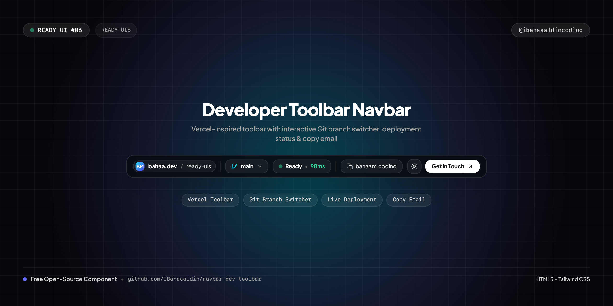
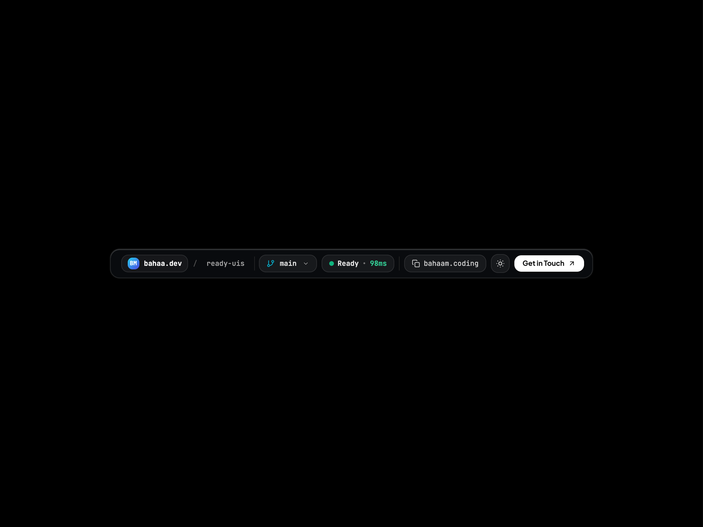
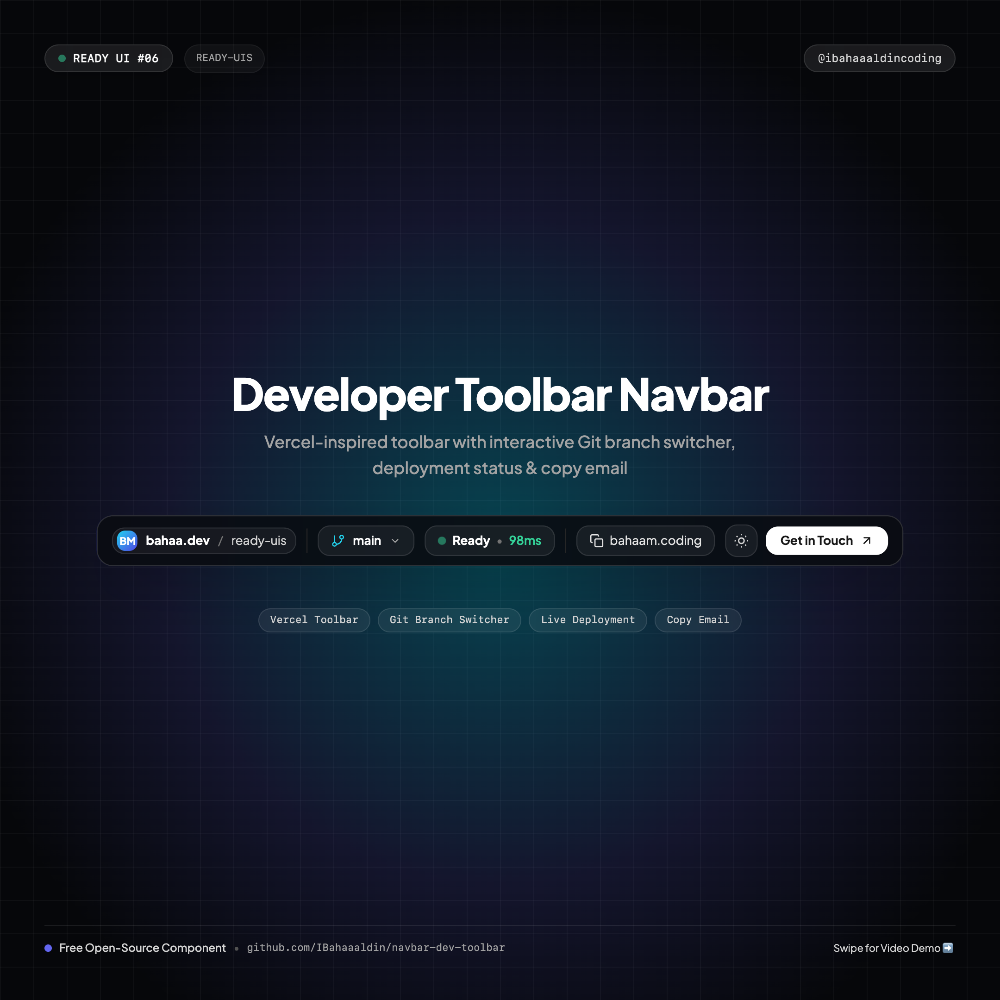
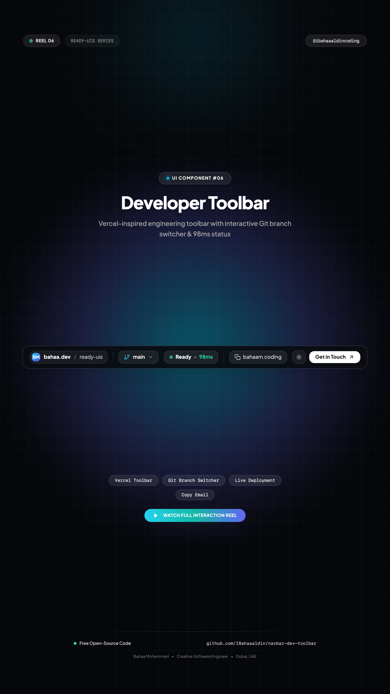

# ⚡ Developer Toolbar Navbar

> A Vercel & GitHub Next-inspired developer toolbar on a minimal canvas featuring an interactive Git branch switcher popover, real-time deployment status indicator, quick copy email tooltip, and dark/light mode.



[](https://IBahaaaldin.github.io/navbar-dev-toolbar/)
[](https://IBahaaaldin.github.io/navbar-dev-toolbar/)

---

## 🌐 Visual Previews

| Desktop Showcase (1200x900) | Mobile Showcase (390x844) | Post Cover (1080x1080) | Reel Cover (1080x1920) |
| :---: | :---: | :---: | :---: |
|  |  |  |  |

*(Includes full interaction videos: `video-desktop.mp4` and `video-mobile.mp4`)*

---

## ✨ Features & Micro-Interactions

- **Clean Minimal Canvas**: Floats dead-center both horizontally and vertically on a pure black (`#000000`) or white (`#ffffff`) canvas with zero clutter.
- **Breadcrumb Navigation**: Path display (`bahaa.dev / ready-uis`) with creator monogram badge.
- **Interactive Git Branch Switcher**:
  - Click the branch pill (`🌿 main`) to toggle a smooth dropdown popover.
  - Select between branches (`main`, `feat/liquid-glass`, `feat/dynamic-island`, `hotfix/theme-switcher`).
  - Active branch label updates dynamically in the navbar.
  - Dismisses on backdrop click.
- **Live Deployment Metric**: Pulsing green status dot with `Ready • 98ms` latency indicator.
- **Interactive Copy Email Tooltip**:
  - Click to copy email to clipboard.
  - Smooth animation transitioning icon to checkmark with an instant `Copied! ✨` tooltip.
- **Strict Single-Line Text**: All elements styled with `whitespace-nowrap` to prevent awkward line breaks.
- **One-Click Theme Switcher**: Sun ☀️ / Moon 🌙 button built directly into the toolbar to flip between dark and light themes.
- **Responsive Mobile Drawer**: Native slide-down menu with git branch status, navigation links, and CTA button.
- **Zero Build Step**: 100% self-contained HTML5 + Tailwind CSS CDN + inline SVGs.

---

## 📁 Repository Structure

```text
├── index.html              # Standalone production navbar component
├── cover.png               # Widescreen cover banner (1280x640)
├── cover-instagram.png     # Square post cover for Instagram (@ibahaaaldincoding) (1080x1080)
├── cover-reel.png          # 9:16 vertical cover for Instagram Reels (1080x1920)
├── screenshot-desktop.png  # Desktop visual preview (1200x900)
├── video-desktop.mp4       # Desktop interaction recording (MP4)
├── screenshot-mobile.png   # Mobile visual preview (390x844)
├── video-mobile.mp4        # Mobile interaction recording (MP4)
├── record.js               # Playwright automation script used to record all 4 assets
├── README.md               # Documentation & setup notes
└── CAPTION.md              # Ready-to-copy Instagram caption for @ibahaaaldincoding
```

---

## 🚀 Quick Start

### 1. View Locally
Simply open `index.html` in your browser:
```bash
open index.html
```

### 2. Interaction
Click the **Git Branch** selector (`main 🌿`) to test the branch switching popover, and click the **Copy Email** button to trigger the instant tooltip!

---

## 📬 Connect

- **Instagram**: [@ibahaaaldincoding](https://www.instagram.com/ibahaaaldincoding)
- **GitHub**: [@IBahaaaldin](https://github.com/IBahaaaldin)
- **LinkedIn**: [Bahaa Mohammed](https://www.linkedin.com/in/bahaa-mohammed-371259369)
- **Email**: bahaam.coding@gmail.com
